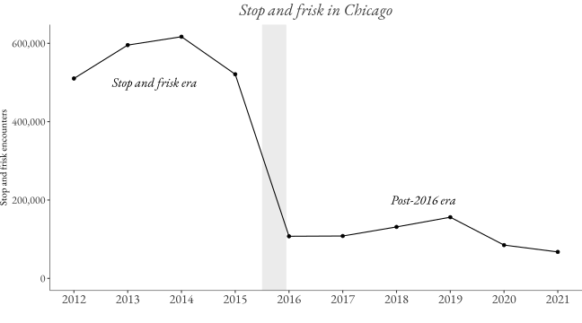
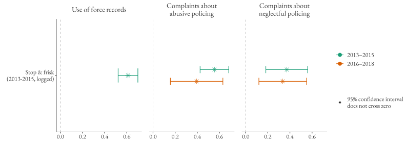
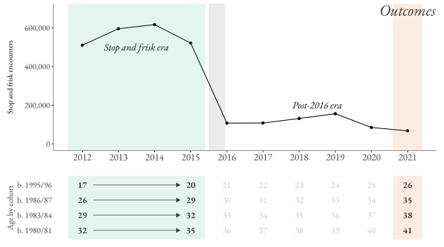
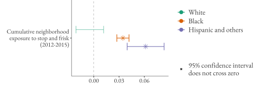

```{r, echo = F}
library(tidyverse)
library(sf)
library(showtext)
library(systemfonts)
options(scipen=999)
options(knitr.kable.NA = '')
#font_add_google("EB Garamond", "ebgaramond")
#showtext_auto()

# Set default ggplot theme
theme_set(
  theme_void(base_size = 14) +
    theme(
      plot.background  = element_rect(fill = NA, colour = NA),
      panel.background = element_rect(fill = NA, colour = NA)
    )
)

# Load your data
load("presentation_files/chicago.geo.RData")
load("presentation_files/dataplot_spatial.RData")
```


## The era of stop & frisk in Chicago

{.r-stretch fig-align="center"}

<div style="margin-top:-40px; font-size: 0.9em;">
> "*In 2014, Chicago police stopped, questioned, and often frisked more than 718,000 people. That was a big number for a city of 2.7 million. It was more than three times the stop* rate *in the place best known for its aggressive stop & frisk policy, New York City*" [@skogan2022stop, p. 1]
</div>


## The neighborhood context of the stop & frisk era in Chicago

<div style="display: flex; gap: 20px;">

<div style="flex: 1;">
Stop & Frisk 2012--2015
<div style="background: none;">
  <object type="image/svg+xml" data="presentation_files/sqf_map.svg" width="500" height="550"></object>
</div>
</div>

<div style="flex: 1; font-size: 0.85em">

&nbsp;

> "*(...) during its peak year of 2014, 90 percent of those stopped were African Americans and Hispanics. From 2013 to 2015 more police enforcement actions were taken in Chicago's predominately African American neighborhoods than there were people living there, every year*" [@skogan2022stop, p. 2]
</div>
  
</div>

## The 'overpolicing-underpolicing paradox'

&nbsp;

<div style="font-size: 0.75em">
> "This process I refer to as the *overpolicing-underpolicing paradox*. Policing seemed to be a ubiquitous part of the lives of many of these marginalized young people; however, the law was rarely there to protect them when they encountered victimization." [@rios2011punished, p. 54]

</div>

&nbsp;

<div style="font-size: 0.75em">
> "One indicator that poor African Americans in particular have been **excluded from police resources** is that police repeatedly fail to respond, or to respond in a timely fashion, when they are called. (...). In response to **police abandonment**, marginalized people **seeking protection** or redress of grievances have generally turned to **'self-help.'**" [@bell2017police, p. 2116]

</div>

<!--
> "I see cops so often in my neighborhood, but when I see something bad going on, I look around and say ‘where are the cops?" [18-year-old girl from Phildelphia interviewed by @carr2007we, pp. 458-459]

</div>
-->

## What are the long-term implications of the stop and frisk era...

&nbsp;

&nbsp;

$\leadsto$ ...for the *persistent* neighborhood concentration of over- *and* **under-policing**?

&nbsp;

&nbsp;

$\leadsto$ ...for **self-help** behavior among residents of those neighborhoods, several years later?


# Part 1 -- Neighborhood-level analysis

## Data and measures

*Neighborhood-level data* ($N=865$ census tracts)

&nbsp;

***[Main independent variable]{.underline}***

&nbsp;


* Stop & Frisk records (2013--2015)

<div style="font-size: 0.85em; margin-top: -50px">
> Counts of contact cards recorded by the CPD
</div>


## Data and measures

***[Main dependent variables]{.underline}***

&nbsp;

* Use-of-force records (2013--2015)

<div style="font-size: 0.85em; margin-top: -50px">
> Counts of Tactical Respose Records (TRR) recorded by the CPD
</div>

* Complaints about abusive policing (2012--2015 \& 2016--2018)

<div style="font-size: 0.85em; margin-top: -50px">
> Counts of CPD complaints in which allegations were: "*use of force*", "*excessive force*", "*verbal abuse*", "*illegal search*", or "*false arrest*"
</div>

* Complaints about neglectful policing (2012--2015 \& 2016--2018)

<div style="font-size: 0.85em; margin-top: -50px">
> Counts of CPD complaints in which the allegations were: "*neglect of duty*", "*inadequate / failure to provide service*", or "*slow / no response*"
</div>


## Data and measures

***[Main control variables]{.underline}***

&nbsp;

$\leadsto$ Police-related variables

<div style="font-size: 0.85em">
* Police-recorded violent crimes (2010--2012)
</div>
<div style="font-size: 0.85em; margin-top: -50px">
> Includes previous records of homicides, robberies, and aggravated assault recorded by the CPD
</div>


$\leadsto$ Structural antecedents (US Census 2010)

<div style="font-size: 0.85em">
* Concentrated disadvantage
* Residential stability 
* Immigrant concentration
* Population density
</div>

<!--
## Estimation strategy

Is the spatial concentration of stop & frisk encounters in 2013--2015 associated with more...

:::: {style="display: flex; align-items: center; gap: 1em; margin: 0.5em 0;"}
::: {style="flex: 0 0 65%;"}
**1)** ...use-of-force records in 2013--2015?
:::
::::

:::: {style="display: flex; align-items: center; gap: 1em; margin: 0.5em 0;"}
::: {.fragment fragment-index=2 style="flex: 0 0 65%;"}
**2)** ...complaints about abusive policing...
:::
::: {.fragment fragment-index=4 style="flex: 1;"}
[→]{style="display: inline-block; transform: rotate(-35deg);"} ...in 2013--2015?\
[→]{style="display: inline-block; transform: rotate(35deg);"} ...in 2016--2018?
:::
::::

:::: {style="display: flex; align-items: center; gap: 1em; margin: 0.5em 0;"}
::: {.fragment fragment-index=3 style="flex: 0 0 65%;"}
**3)** ...complaints about neglectful policing...
:::
::: {.fragment fragment-index=4 style="flex: 1;"}
[→]{style="display: inline-block; transform: rotate(-35deg);"} ...in 2013--2015?\
[→]{style="display: inline-block; transform: rotate(35deg);"} ...in 2016--2018?
:::
::::

::: {style="height: 0.35em;"}
:::

$\leadsto$ Poisson SLX models: spatial lags of all covariates, Conley SEs^[Queen contiguity, row-standardised weights; Conley cutoff = 2 km. Linear SLX models with `log(y+1)` and `asinh(y)` outcomes yield substantively identical results.]

-->

## The persistent neighborhood concentration of over- and under-policing

{.r-stretch fig-align="center"}
<div style="font-size: 0.5em;margin-top:-10px">
> 5x Poisson SLX models (Conley SEs) controlling for concentrated disadvantage, residential stability, immigrant concentration, population density, and spatial lags. $N=846$. (Linear SLX models with `log(y+1)` and `asinh(y)` outcomes yield substantively identical results).

</div>

# Part 2 -- Individual-level analysis

##  Data and measures

**Project on Human Development in Chicago Neighborhoods (PHDCN)**

-   6200 children from 7 age cohorts, born 1978 to 1996
-   3 interviews from 1995--2003
-   Representative of Chicago and its neighborhoods

::: {.fragment fragment-index=2;"}
### {width=200px height=150px}

<div style="margin-top:-100px">
-   60% subsample of 4 cohorts
-   1057 interviewed in 2012
-   682 followed-up in 2021
-   Followed throughout the US
</div>
:::


##  Analytic strategy

287 PHDCN+ respondents were living in Chicago from 2012 to 2015, the *era of stop & frisk* [@skogan2022stop]

{.r-stretch fig-align="center"}

## Analytic strategy

&nbsp;

**Independent variable**: Cumulative neighborhood exposure to stop and frisk (2012--2015)

<div style="font-size: 0.65em">
> We define $D_{ijt}$ where $T \in \{1, 2, 3, 4\}$ as the number of stop and frisk encounters in neighborhood $j$ where respondent $i$ was residing during period $t$. Periods here refer to years 2012 ($t=1$) through 2015 ($t=5$). We then define cumulative neighborhood exposure to stop and frisk as $cum(D_{i})= \sum_{t=1}^{4}d_{ijt}$, i.e., the sum of all SQFs per individual across this four-year period
</div>

&nbsp;

::: {.fragment fragment-index=2;"}
**Dependent variable**: Gun carrying in adulthood (2021)

<div style="font-size: 0.65em">
> Have you ever carried a concealed or hidden gun with you anywhere?\
> 1: Yes, in the last 12 months\
> 0: No, not in the last 12 months
</div>
:::


## Estimation strategy

Marginal structural models with residual balancing <div style="font-size: 0.75em">[@zhou2020residual]</div>

<div style="font-size: 0.65em; margin-top:-10px">
> Neighborhood exposure to violent crime is a time-varying confounder, as SQFs and violent crime are dynamically related. Weights created using residual balancing permits appropriatelly controlling for time-varying confounders without introducing over-control bias.
</div>

::: {.fragment fragment-index=2;"}
Other (pre-exposure) controls:

* Gender | Cohort fixed effects | Previous offending behavior
* Immigration status | Primary caregiver's education
* CBCL internalizing scores | CBCL externalizing scores

<div style="font-size: 0.65em; margin-top:-30px">
> The Child Behavior Checklist (CBCL) survey instrument was a parent-report questionnaire on which the child was rated on various behavioral and emotional problems.
</div>
:::

$\leadsto$ Effects disaggregated by race: White, Black, Hispanic


## Long-term implications of the stop and frisk era for residents

Probability of gun carrying in adulthood

&nbsp;

{.r-stretch fig-align="center"}

<div style="font-size: 0.65em;">
> Marginal structural models estimated as Firth’s penalized linear probability models with weights created using residual balancing to control for dynamic exposure to neighborhood violence and robust Huber-White standard errors. $N=257$.

</div>

# Some concluding thoughts

## Some concluding thoughts

&nbsp;

In Chicago, aggressive policing tactics were widely used between 2012 and 2015 -- the *stop & frisk era* [@skogan2022stop]

<div style="font-size: 0.75em">
> "Confrontational proactive policing methods may have social benefits in crime reduction but costs in intrusion on the rights and privacy of innocent persons" [@manski2017assessing, p. 9308]

</div>

::: {.fragment fragment-index=2;"}
<div style="font-size: 0.85em; margin-top: -10px">
* Neighborhoods with more SQFs are more likely to have more...
  * ...incidents of police use-of-force
  * ...complaints of abuse of police power
  * **...complaints of neglect and unresponsiveness**

$\leadsto$ These associations persist even after the end of the *stop & frisk era*
</div>

:::

## Some concluding thoughts

&nbsp;

> "I see cops so often in my neighborhood, but when I see something bad going on, I look around and say ‘where are the cops?" [18-year-old girl from Phildelphia interviewed by @carr2007we, pp. 458-459]

&nbsp;

$\leadsto$ Implications of the "overpolicing-underpolicing paradox" for gun-carrying behavior, even years later


## Some concluding thoughts

&nbsp;

<div style="font-size: 0.75em; margin-top:-10px">
> "(...) there are thee Chicagos, not one. The city's large White, African American, and Hispanic neighborhoods differ dramatically in character, including their distinctive crime problems and their relationship with the police. In important ways residents live in different worlds" [@skogan2022stop, p. 18]

</div>

&nbsp;


* Long-term implications for gun carrying among Black and Latino residents of neighborhoods where SQF concentrated in 2012--2015

<div style="margin-left:100px">
$\leadsto$ Not for White residents
</div>


# Thank you!

<br><br>

<div style="text-align:left; margin-left:200px; font-size:1.2em; line-height:2;">
  <i class="fa fa-envelope"></i> 
  <a href="mailto:thiago.oliveira@manchester.ac.uk">thiago.oliveira@manchester.ac.uk</a> <br>

  <i class="fa fa-home"></i> 
  <a href="https://www.thiagoroliveira.com">ThiagoROliveira.com</a> <br>

  <i class="fa-brands fa-linkedin"></i> 
  <a href="https://www.linkedin.com/in/thiago-oliveira-a3892142a/">\@thiago-oliveira</a>
</div>

## References